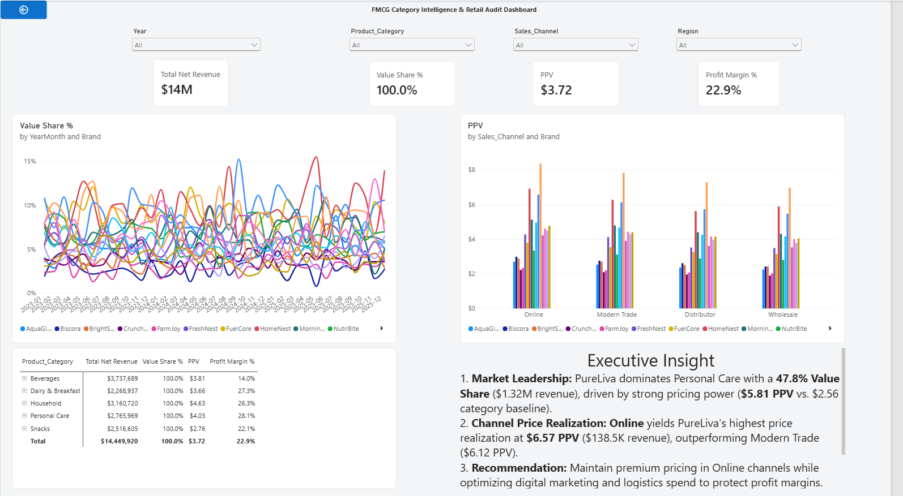
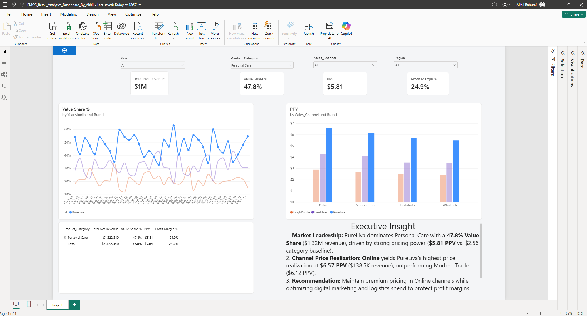

# 📊 FMCG Retail Audit & Category Intelligence Dashboard

An executive-level FMCG Retail Audit dashboard designed to simulate Nielsen / NIQ category management readouts. This project analyzes market share trajectories, price realization per volume (PPV), channel dynamics, and product-level profitability across 18,000+ retail transactions (2023–2025).

## 🖼️ Dashboard Preview

### Executive Overview Canvas


### Category & Channel Price Realization


## 🎯 Executive Summary & Key Insights

1. **Market Share Leadership:**
   * **PureLiva** dominates the *Personal Care* category with a **47.8% Value Share** ($1.32M Net Revenue), significantly outperforming competing brands in Modern Trade and Online channels.

2. **Channel Price Realization (PPV):**
   * **Online** yields the highest unit price realization at **$6.57 PPV** (vs. $6.12 in Modern Trade, $5.72 in Distributor, and $5.47 in Wholesale).

3. **Margin vs. Realization Tradeoff:**
   * While Online commands the highest selling price per unit ($6.57 PPV), **Wholesale and Distributor** channels generate higher net profit margins (27.8% and 27.5% respectively) due to lower fulfillment and logistics overhead compared to Online (14.2% margin).

4. **Strategic Recommendation:**
   * Defend shelf placement and expand supply chain efficiency in Modern Trade while maintaining premium pricing in Online channels to preserve brand equity.

## 📐 Data Model Architecture (Star Schema)

The model connects a single fact table containing 18,000+ sales records to a dedicated calendar dimension table via a 1-to-Many relationship.

```
+------------------------+             +---------------------------------------------+
|        Dim_Date        |             |  fmcg_sales_marketing_profitability_2023_2025|
+------------------------+             +---------------------------------------------+
| Date (PK)              | 1        *  | Order_ID                                    |
| Year                   +------------>| Order_Date (FK)                             |
| Month                  |             | Brand                                       |
| MonthNo                |             | Product_Category                            |
| YearMonth              |             | SKU                                         |
| Quarter                |             | Sales_Channel                               |
+------------------------+             | Net_Revenue_USD                             |
                                       | Units_Sold                                  |
                                       | Profit_USD                                  |
                                       +---------------------------------------------+
```

## 🧮 Key DAX Calculations

All calculations are organized within a dedicated `_Measures` table:

```DAX
-- Total Sales Volume
Total Net Revenue = 
SUM('fmcg_sales_marketing_profitability_2023_2025'[Net_Revenue_USD])

-- Category Total Sales (Ignores Brand Filter to calculate Market Share Base)
Category Net Revenue = 
CALCULATE(
    [Total Net Revenue],
    REMOVEFILTERS('fmcg_sales_marketing_profitability_2023_2025'[Brand])
)

-- Value Share % (Market Share)
Value Share % = 
DIVIDE([Total Net Revenue], [Category Net Revenue], 0)

-- Price Per Volume / Unit (PPV)
PPV = 
DIVIDE([Total Net Revenue], SUM('fmcg_sales_marketing_profitability_2023_2025'[Units_Sold]), 0)

-- Prior Year Market Share
Value Share LY = 
CALCULATE([Value Share %], SAMEPERIODLASTYEAR('Dim_Date'[Date]))

-- Year-over-Year Share Shift
Share Change YoY = 
[Value Share %] - [Value Share LY]
```

## 🧰 Dashboard Features & Interactivity

* **Interactive Global Slicers:** Dynamic dropdown filtering across `Year`, `Product Category`, `Sales Channel`, and `Region`.
* **KPI Scorecards:** Real-time visibility into `Net Revenue`, `Value Share %`, `PPV ($/Unit)`, and `Profit Margin %`.
* **Market Share Trajectory Chart:** Line chart tracking monthly brand market share fluctuation over time.
* **Pricing Realization Chart:** Clustered bar chart evaluating brand PPV across sales channels (*Online*, *Modern Trade*, *Distributor*, *Wholesale*).
* **SKU Drill-Down Matrix:** Hierarchical grid allowing seamless drill-down from `Product Category` $\rightarrow$ `Brand` $\rightarrow$ `SKU`.
* **Executive Callout Box:** Structured "So What?" narrative detailing tactical and strategic takeaways for leadership.

## 💻 How to View & Run the Dashboard

1. **Prerequisites:** Install [Power BI Desktop](https://powerbi.microsoft.com/desktop/) (Free).
2. **Clone / Download Repo:**
   ```bash
   git clone https://github.com/YOUR_USERNAME/fmcg-retail-audit-dashboard.git
   ```
3. **Open the File:** Double-click `FMCG_Retail_Audit_Dashboard.pbix` to launch the dashboard in Power BI Desktop.
4. **Explore Data:** Interact with slicers, drill down into Matrix SKUs, or review DAX formulas in the **Model View**.

## 👤 Author & Contact

* **Developer:** Akhil Baburaj
* **Domain:** Data Analytics | FMCG & Retail Category Intelligence
* **Dataset:** FMCG Sales, Marketing & Profitability (2023–2025)